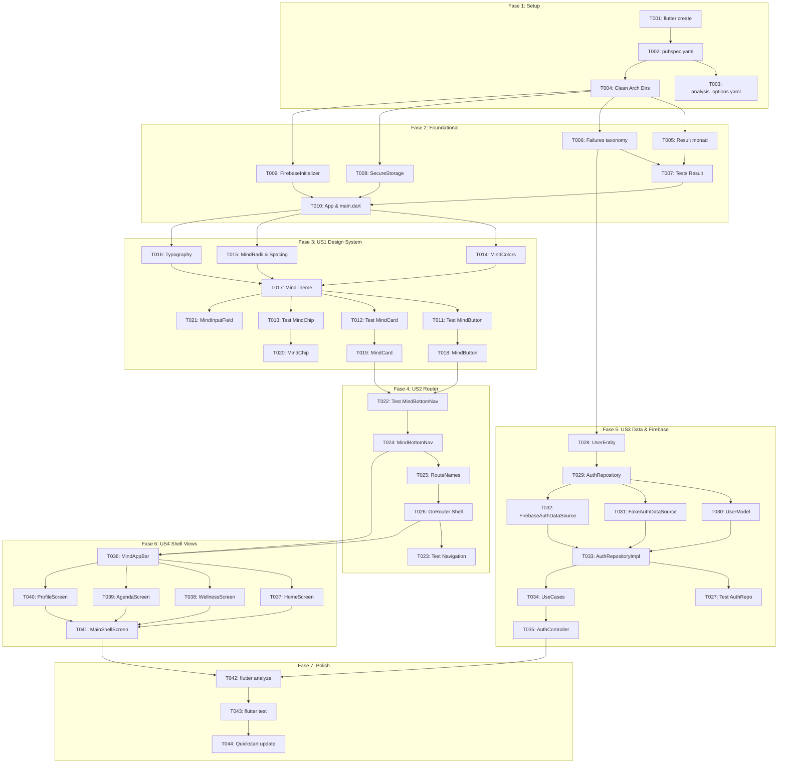

# Tasks: 001-core-foundation

**Input**: Design documents from `specs/001-core-foundation/`  
**Prerequisites**: `plan.md`, `spec.md`, `data-model.md`, `contracts/`, `research.md`, `quickstart.md`, `.specify/memory/constitution.md`  
**Branch**: `001-core-foundation`  

## Format: `[ID] [P?] [Story] Description`
- **[P]**: Puede ejecutarse en paralelo (archivos independientes sin bloqueos)
- **[Story]**: Historia de usuario correspondiente (`US1`, `US2`, `US3`, `US4`)
- Rutas de archivo exactas en cada tarea

---

## Phase 1: Setup (Infraestructura Compartida)

**Purpose**: Inicialización del proyecto Flutter, configuración de dependencias y análisis estático.

- [ ] T001 Inicializar proyecto Flutter con organización `com.minduc` y nombre `minduc` en la raíz del repositorio ejecutando `flutter create --org com.minduc --project-name minduc .`
- [ ] T002 Configurar `pubspec.yaml` con dependencias base (`flutter_riverpod: ^2.6.1`, `go_router: ^14.6.2`, `firebase_core: ^3.8.0`, `firebase_auth: ^5.3.3`, `cloud_firestore: ^5.5.0`, `google_fonts: ^6.2.1`, `flutter_svg: ^2.0.16`, `flutter_animate: ^4.5.2`, `flutter_secure_storage: ^9.2.2`, `mocktail: ^1.0.4`) y ejecutar `flutter pub get`
- [ ] T003 [P] Configurar `analysis_options.yaml` con linter estricto de `flutter_lints`, `sound null safety` y exclusiones para mocks en `analysis_options.yaml`
- [ ] T004 [P] Crear el árbol de directorios de Clean Architecture (`lib/core/`, `lib/features/`, `assets/icons/`, `test/unit/`, `test/widget/`)

---

## Phase 2: Foundational (Prerrequisitos de Arquitectura)

**Purpose**: Infraestructura transversal obligatoria previa a la implementación de cualquier historia de usuario.

- [ ] T005 [P] Implementar la monada funcional `Result<T, Failure>` y subclases `Success` y `FailureResult` en `lib/core/error/result.dart`
- [ ] T006 [P] Implementar la taxonomía de errores de dominio (`AppFailure`, `AuthFailure`, `NetworkFailure`, `ServerFailure`, `CacheFailure`) en `lib/core/error/failures.dart`
- [ ] T007 [P] Implementar pruebas unitarias de `Result` y jerarquía de fallos en `test/unit/core/result_test.dart`
- [ ] T008 [P] Implementar servicio de almacenamiento seguro local `SecureStorageService` en `lib/core/storage/secure_storage_service.dart`
- [ ] T009 [P] Implementar `FirebaseInitializer` con persistencia offline de Firestore y arranque seguro condicional en `lib/core/firebase/firebase_initializer.dart`
- [ ] T010 Implementar punto de entrada `main.dart` y widget raíz `App` con `ProviderScope` y `MaterialApp.router` en `lib/main.dart` y `lib/app.dart`

**Checkpoint**: Base transversal completa y ejecutable con tests unitarios pasando.

---

## Phase 3: User Story 1 - Sistema de Diseño y Tema Visual Fiel a Figma (Priority: P1) 🎯 MVP

**Goal**: Proveer el sistema de diseño centralizado Material 3 adaptado con exactitud a los 12 mockups de Figma (colores serenos, radios de 22 dp, tipografía y componentes atómicos).

**Independent Test**: La suite de pruebas de widgets valida que `MindCard`, `MindButton`, `MindChip` y `MindInputField` renderizan con las proporciones, radios y contrastes exactos de Figma.

### Tests para User Story 1
- [ ] T011 [P] [US1] Escribir prueba de widget para `MindButton` (estados normal, loading, disabled, outlined) en `test/widget/core/design_system/mind_button_test.dart`
- [ ] T012 [P] [US1] Escribir prueba de widget para `MindCard` (radios 22dp, variantes de color de categoría) en `test/widget/core/design_system/mind_card_test.dart`
- [ ] T013 [P] [US1] Escribir prueba de widget para `MindChip` (selección, dot indicador, colores de bienestar) en `test/widget/core/design_system/mind_chip_test.dart`

### Implementación de User Story 1
- [ ] T014 [P] [US1] Implementar tokens de color de Figma (`MindColors`: fondo `#FBF9F4`, salvia `#718E81`, categorías autocuidado, estudio, salud mental, descanso) en `lib/core/theme/mind_colors.dart`
- [ ] T015 [P] [US1] Implementar constantes geométricas de radios y espaciados (`MindRadii`: 22dp tarjeta, 30dp botón; `MindSpacing`) en `lib/core/theme/mind_radii.dart` y `lib/core/theme/mind_spacing.dart`
- [ ] T016 [P] [US1] Configurar escala tipográfica con Google Fonts (Plus Jakarta Sans) en `lib/core/theme/mind_typography.dart`
- [ ] T017 [US1] Ensamblar `MindTheme` (ThemeData claro y oscuro conColorScheme y TextTheme de mindUC) en `lib/core/theme/mind_theme.dart`
- [ ] T018 [US1] Implementar componente `MindButton` (botón píldora animado con retroalimentación háptica y estados) en `lib/core/design_system/buttons/mind_button.dart`
- [ ] T019 [US1] Implementar componente `MindCard` (tarjeta serena con curvatura 22dp y tintes suaves) en `lib/core/design_system/cards/mind_card.dart`
- [ ] T020 [US1] Implementar componente `MindChip` (chips de filtrado y etiquetas de bienestar con dot) en `lib/core/design_system/chips/mind_chip.dart`
- [ ] T021 [US1] Implementar componente `MindInputField` (campo de texto minimalista con prefijo/sufijo y validación) en `lib/core/design_system/inputs/mind_input_field.dart`

**Checkpoint**: User Story 1 completa y verificable con tests de widgets exitosos.

---

## Phase 4: User Story 2 - Navegación Persistente de 4 Pestañas con GoRouter (Priority: P1)

**Goal**: Implementar la navegación declarativa con GoRouter y `StatefulShellRoute.indexedStack` para las 4 pestañas de la barra inferior (Inicio, Bienestar, Agenda, Perfil), reteniendo el estado de cada vista al cambiar.

**Independent Test**: Prueba de navegación en widget test valida que cambiar entre pestañas no reinicia las instancias de cada pantalla y mantiene el índice seleccionado.

### Tests para User Story 2
- [ ] T022 [P] [US2] Escribir prueba de widget para la barra inferior personalizada `MindBottomNavBar` en `test/widget/core/design_system/mind_bottom_nav_test.dart`
- [ ] T023 [P] [US2] Escribir prueba de navegación GoRouter (preservación de estado entre pestañas y rutas) en `test/widget/core/router/app_router_test.dart`

### Implementación de User Story 2
- [ ] T024 [P] [US2] Implementar componente `MindBottomNavBar` (barra inferior de 4 destinos idéntica a Figma con iconos serenos y badges) en `lib/core/design_system/navigation/mind_bottom_nav_bar.dart`
- [ ] T025 [P] [US2] Definir rutas y constantes de navegación (`AppRoutes`: `/home`, `/wellness`, `/agenda`, `/profile`, `/auth`) en `lib/core/router/route_names.dart`
- [ ] T026 [US2] Configurar `AppRouter` con `StatefulShellRoute.indexedStack` y NavigatorKeys independientes para cada rama en `lib/core/router/app_router.dart`

**Checkpoint**: User Stories 1 y 2 integradas; navegación fluida a 60 fps entre las 4 ramas.

---

## Phase 5: User Story 3 - Capa de Datos, Abstracción de Repositorios y Firebase (Priority: P1)

**Goal**: Establecer la infraestructura de datos limpia desacoplada con soporte para Firebase Auth y Cloud Firestore bajo arquitectura Offline-First y mocks para desarrollo.

**Independent Test**: Pruebas unitarias prueban `AuthRepositoryImpl` contra `FakeAuthDataSource` validando flujos de login, registro, mapeo de DTOs y manejo de errores con `Result`.

### Tests para User Story 3
- [ ] T027 [P] [US3] Escribir pruebas unitarias para `AuthRepositoryImpl` con casos de éxito y fallos tipados en `test/unit/features/auth/auth_repository_test.dart`

### Implementación de User Story 3
- [ ] T028 [P] [US3] Crear entidad pura de dominio `UserEntity` en `lib/features/auth/domain/entities/user_entity.dart`
- [ ] T029 [P] [US3] Definir contrato abstracto `AuthRepository` en `lib/features/auth/domain/repositories/auth_repository.dart`
- [ ] T030 [P] [US3] Crear DTO `UserModel` con serialización Firestore y mapeador a `UserEntity` en `lib/features/auth/data/models/user_model.dart`
- [ ] T031 [P] [US3] Implementar fuente de datos de pruebas `FakeAuthDataSource` para testing y desarrollo local sin credenciales en `lib/features/auth/data/datasources/fake_auth_datasource.dart`
- [ ] T032 [US3] Implementar `FirebaseAuthDataSource` conectando a Firebase Auth y Firestore con modo offline en `lib/features/auth/data/datasources/auth_remote_datasource.dart`
- [ ] T033 [US3] Implementar `AuthRepositoryImpl` implementando `AuthRepository` con manejo de `Result<T, AppFailure>` en `lib/features/auth/data/repositories/auth_repository_impl.dart`
- [ ] T034 [P] [US3] Implementar casos de uso `SignInUseCase` y `SignUpUseCase` en `lib/features/auth/domain/usecases/sign_in_usecase.dart` y `sign_up_usecase.dart`
- [ ] T035 [US3] Proveer inyección de dependencias de autenticación mediante Riverpod en `lib/features/auth/presentation/controllers/auth_controller.dart`

**Checkpoint**: Capa de datos y autenticación 100% testeable de forma aislada.

---

## Phase 6: User Story 4 - Vistas Shell Base y Encabezados de Marca (Priority: P2)

**Goal**: Renderizar las pantallas base de las 4 pestañas y el encabezado de marca contextual (`mindUC`, sección, notificaciones, perfil) adaptado a los safe areas de dispositivos móviles.

**Independent Test**: La app arranca y renderiza visualmente las 4 vistas con sus AppBars correspondientes sin ningún `RenderFlex overflow`.

### Implementación de User Story 4
- [ ] T036 [P] [US4] Implementar encabezado reutilizable `MindAppBar` con logo mindUC, título, campana de notificación y avatar en `lib/core/design_system/navigation/mind_app_bar.dart`
- [ ] T037 [P] [US4] Implementar pantalla base de Inicio (`HomeScreen`) con encabezado "Inicio", fecha y selector de estado de ánimo en `lib/features/home/presentation/screens/home_screen.dart`
- [ ] T038 [P] [US4] Implementar pantalla base de Bienestar (`WellnessScreen`) con encabezado "Bienestar", Sanctuary Mode y cuadrícula 2x2 en `lib/features/wellness/presentation/screens/wellness_screen.dart`
- [ ] T039 [P] [US4] Implementar pantalla base de Agenda (`AgendaScreen`) con encabezado "Agenda", selector de semana y lista inicial en `lib/features/agenda/presentation/screens/agenda_screen.dart`
- [ ] T040 [P] [US4] Implementar pantalla base de Perfil (`ProfileScreen`) con encabezado "Perfil", tarjeta de estudiante y acceso a Línea de Crisis en `lib/features/profile/presentation/screens/profile_screen.dart`
- [ ] T041 [US4] Implementar contenedor maestro `MainShellScreen` integrando `StatefulNavigationShell`, `MindAppBar` y `MindBottomNavBar` en `lib/core/design_system/navigation/main_shell_screen.dart`

**Checkpoint**: Shell completo y navegable en emulador/dispositivo en las 4 secciones principales.

---

## Phase 7: Polish & Cross-Cutting Concerns

**Purpose**: Verificación integral de calidad, análisis estático estricto y ejecución de pruebas.

- [ ] T042 [P] Ejecutar `flutter analyze` y corregir cualquier advertencia o violación de estilo
- [ ] T043 Ejecutar suite completa de tests `flutter test` asegurando 100% de éxito en pruebas unitarias y de widgets
- [ ] T044 Actualizar `specs/001-core-foundation/quickstart.md` con los comandos validados de ejecución

---

## Dependencies & Execution Order

---

## Implementation Strategy

### MVP First (Phases 1, 2, 3)
1. Completar Setup y Fundaciones.
2. Implementar y validar con widget tests todo el Sistema de Diseño de Figma (`MindTheme`, `MindButton`, `MindCard`, `MindChip`, `MindInputField`).
3. **Punto de control visual**: Los componentes coinciden con los mockups.

### Entrega Incremental
1. **Incremento 1**: Sistema de Diseño probado de forma aislada.
2. **Incremento 2**: Enrutador GoRouter de 4 pestañas operando con `StatefulShellRoute`.
3. **Incremento 3**: Capa de datos desacoplada y repositorio de autenticación con `FakeAuthDataSource` para tests y `FirebaseAuthDataSource` para producción.
4. **Incremento 4**: Shell integrado con las 4 vistas base (`Inicio`, `Bienestar`, `Agenda`, `Perfil`).
5. **Incremento 5**: Verificación integral con `flutter analyze` y `flutter test`.
