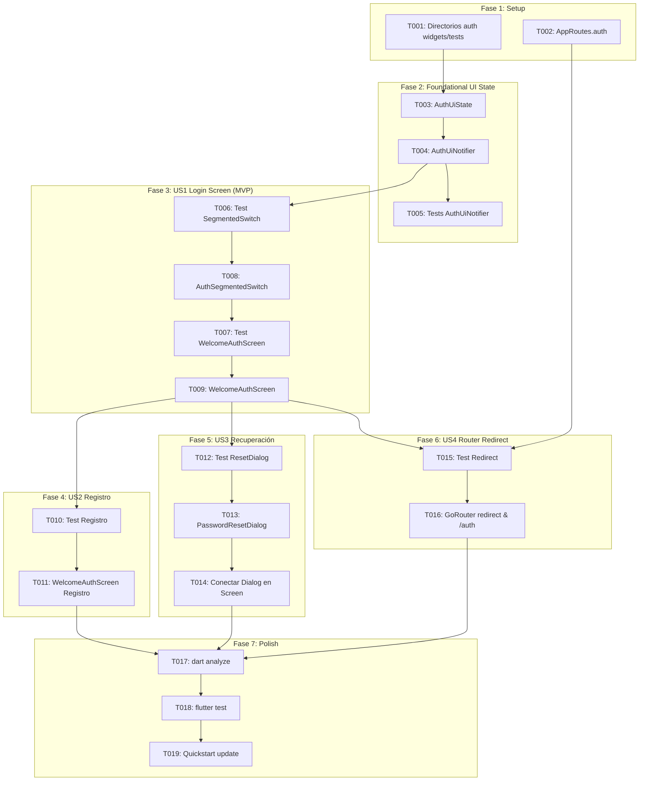

# Tasks: 002-auth-welcome

**Input**: Design documents from `specs/002-auth-welcome/`  
**Prerequisites**: `plan.md`, `spec.md`, `data-model.md`, `contracts/`, `research.md`, `quickstart.md`, `.specify/memory/constitution.md`  
**Branch**: `002-auth-welcome`  

## Format: `[ID] [P?] [Story] Description`
- **[P]**: Puede ejecutarse en paralelo (archivos independientes sin bloqueos)
- **[Story]**: Historia de usuario correspondiente (`US1`, `US2`, `US3`, `US4`)
- Rutas de archivo exactas en cada tarea

---

## Phase 1: Setup (Infraestructura de Presentación)

**Purpose**: Estructura de directorios y rutas para la interfaz de bienvenida y autenticación.

- [X] T001 [P] Crear el directorio de widgets de autenticación en `lib/features/auth/presentation/widgets/` y directorio de tests en `test/widget/features/auth/`
- [X] T002 [P] Confirmar la constante `AppRoutes.auth = '/auth'` en `lib/core/router/route_names.dart`

---

## Phase 2: Foundational (Prerrequisitos de Estado de UI)

**Purpose**: Controlador reactivo de presentación y modelo de estado de autenticación.

- [X] T003 [P] Implementar la clase inmutable `AuthUiState` (modo login/registro, visibilidad de clave, loading y mensajes de error) en `lib/features/auth/presentation/controllers/auth_ui_state.dart`
- [X] T004 [P] Implementar el `StateNotifier<AuthUiState>` (`AuthUiNotifier`) y provider en `lib/features/auth/presentation/controllers/auth_controller.dart` conectando con `SignInUseCase`, `SignUpUseCase` y `AuthRepository`
- [X] T005 [P] Implementar pruebas unitarias de `AuthUiNotifier` en `test/unit/features/auth/auth_controller_test.dart`

**Checkpoint**: Estado reactivo de UI testeado y desacoplado del árbol de widgets.

---

## Phase 3: User Story 1 - Inicio de Sesión Sereno y Acceso al Espacio Personal (Priority: P1) 🎯 MVP

**Goal**: Implementar la pantalla oficial de Bienvenida y Autenticación con fidelidad absoluta al mockup de Figma (`mindUC - Bienvenida y Autenticación.png`), permitiendo a estudiantes iniciar sesión con correo `@uc.cl` o personal.

**Independent Test**: La suite de pruebas de widgets valida que `WelcomeAuthScreen` renderiza el emblema botánico, píldoras, campos de texto, botón con feedback de carga y navega a `/home` al autenticar.

### Tests para User Story 1
- [X] T006 [P] [US1] Escribir prueba de widget para el selector segmentado `AuthSegmentedSwitch` en `test/widget/features/auth/auth_segmented_switch_test.dart`
- [X] T007 [P] [US1] Escribir pruebas de widget para `WelcomeAuthScreen` (renderizado de Figma, validación de inputs y feedback de carga) en `test/widget/features/auth/welcome_auth_screen_test.dart`

### Implementación de User Story 1
- [X] T008 [US1] Implementar componente `AuthSegmentedSwitch` (contenedor con dos pestañas y slider animado blanco) en `lib/features/auth/presentation/widgets/auth_segmented_switch.dart`
- [X] T009 [US1] Implementar la pantalla completa `WelcomeAuthScreen` (cabecera, emblema botánico circular, píldora de Bienestar Estudiantil, titular, campos de correo y contraseña con toggle de ojo, botón primario y tagline inferior) en `lib/features/auth/presentation/screens/welcome_auth_screen.dart`

**Checkpoint**: User Story 1 completa y verificable con login funcional.

---

## Phase 4: User Story 2 - Selector Segmentado y Registro de Nuevos Estudiantes (Priority: P1)

**Goal**: Permitir a nuevos estudiantes alternar al modo "Registrarse" en el mismo contenedor para ingresar nombre, carrera y correo institucional, creando su cuenta en Firebase y Firestore.

**Independent Test**: Al pulsar "Registrarse", la tarjeta expande suavemente los campos de nombre/carrera, valida contraseña >= 6 caracteres y crea el usuario.

### Tests para User Story 2
- [X] T010 [P] [US2] Agregar casos de prueba de widget para el modo registro y validaciones de contraseña corta en `test/widget/features/auth/welcome_auth_screen_test.dart`

### Implementación de User Story 2
- [X] T011 [US2] Habilitar la transición reactiva a modo registro en `WelcomeAuthScreen` (inclusión de campos de nombre completo y departamento, botón con texto "Crear mi cuenta" y llamada a `signUp`) en `lib/features/auth/presentation/screens/welcome_auth_screen.dart`

**Checkpoint**: Registro e inicio de sesión integrados en el mismo contenedor visual.

---

## Phase 5: User Story 3 - Recuperación de Contraseña sin Estrés (Priority: P2)

**Goal**: Permitir la recuperación de contraseña mediante un diálogo modal sereno que envía el correo de restablecimiento a través de Firebase.

**Independent Test**: Al pulsar "¿Olvidaste tu contraseña?", se abre `PasswordResetDialog`, se ingresa el correo y se muestra la confirmación tranquilizadora.

### Tests para User Story 3
- [X] T012 [P] [US3] Escribir prueba de widget para `PasswordResetDialog` en `test/widget/features/auth/password_reset_dialog_test.dart`

### Implementación de User Story 3
- [X] T013 [US3] Implementar componente `PasswordResetDialog` en `lib/features/auth/presentation/widgets/password_reset_dialog.dart`
- [X] T014 [US3] Conectar el enlace "¿Olvidaste tu contraseña?" en `WelcomeAuthScreen` para invocar el diálogo y llamar a `sendPasswordResetEmail`

**Checkpoint**: Recuperación de contraseña completada y testeada.

---

## Phase 6: User Story 4 - Redirección Reactiva de Sesión en GoRouter (Priority: P1)

**Goal**: Configurar GoRouter para escuchar los cambios de autenticación; si no hay sesión activa redirige a `/auth`, y si el usuario se autentica o tiene sesión activa navega a `/home`.

**Independent Test**: Prueba de integración de GoRouter verifica que una sesión activa entra a `/home`, y un logout redirige a `/auth`.

### Tests para User Story 4
- [X] T015 [P] [US4] Escribir prueba de widget de redirección en `test/widget/core/router/auth_redirect_test.dart`

### Implementación de User Story 4
- [X] T016 [US4] Actualizar `lib/core/router/app_router.dart` registrando la ruta `AppRoutes.auth` con `WelcomeAuthScreen` y la lógica reactiva de `redirect` según el estado de `AuthRepository`

**Checkpoint**: Flujo de navegación protegido y reactivo entre login y el shell de la aplicación.

---

## Phase 7: Polish & Cross-Cutting Concerns

**Purpose**: Verificación integral de calidad, análisis estático y suite de pruebas.

- [X] T017 [P] Ejecutar `dart analyze` y resolver cualquier advertencia o violación de estilo
- [X] T018 Ejecutar suite completa `flutter test` asegurando 100% de éxito en tests unitarios y de widgets
- [X] T019 Actualizar `specs/002-auth-welcome/quickstart.md` con los comandos de prueba verificados

---

## Dependencies & Execution Order

