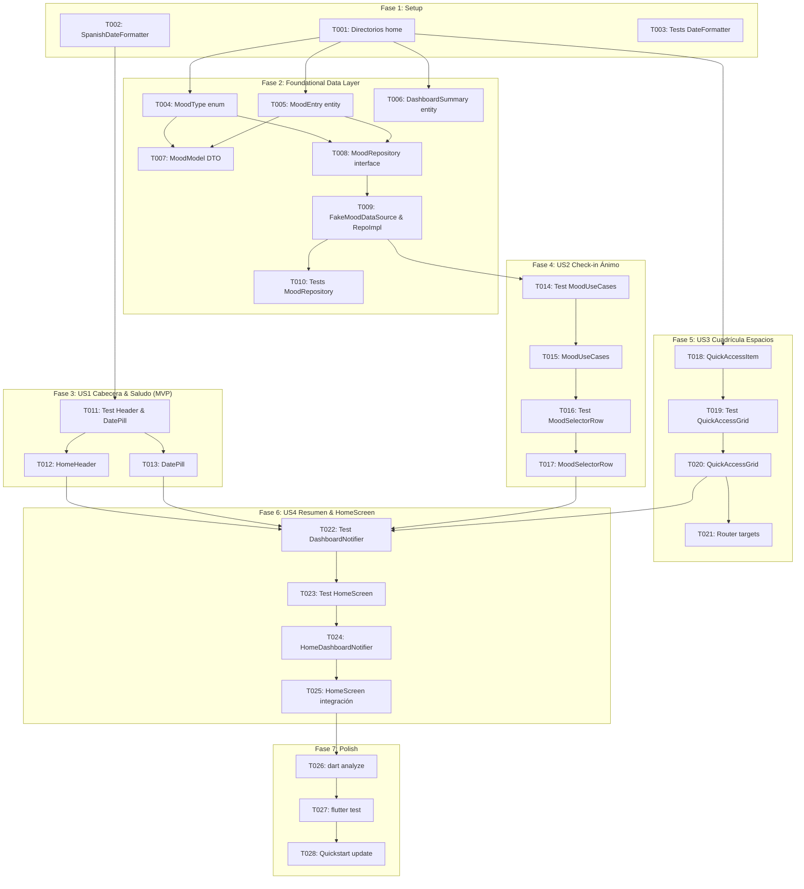

# Tasks: 003-home-dashboard

**Input**: Design documents from `specs/003-home-dashboard/`  
**Prerequisites**: `plan.md`, `spec.md`, `data-model.md`, `contracts/home_ui_contract.md`, `research.md`, `quickstart.md`, `.specify/memory/constitution.md`  
**Branch**: `003-home-dashboard`  

## Format: `[ID] [P?] [Story] Description`

- **[P]**: Puede ejecutarse en paralelo (archivos independientes sin dependencias cruzadas directas)
- **[Story]**: Historia de usuario correspondiente (`US1`, `US2`, `US3`, `US4`)
- Rutas de archivo exactas en cada tarea

---

## Phase 1: Setup (Infraestructura y Formateo)

**Purpose**: Estructura de directorios de la feature y utilidades compartidas de fecha.

- [ ] T001 Crear estructura de directorios en `lib/features/home/` (`domain/entities/`, `domain/repositories/`, `domain/usecases/`, `data/datasources/`, `data/models/`, `data/repositories/`, `presentation/controllers/`, `presentation/widgets/`, `presentation/screens/`) y directorios de test en `test/unit/features/home/` y `test/widget/features/home/`
- [ ] T002 Implementar utilidad pura `SpanishDateFormatter` en `lib/core/utils/date_formatter.dart` para formatear fechas en español con formato "EEEE, d 'de' MMMM" (ej. "Jueves, 24 de Octubre")
- [ ] T003 [P] Escribir pruebas unitarias para `SpanishDateFormatter` en `test/unit/core/date_formatter_test.dart`

---

## Phase 2: Foundational (Modelos de Dominio y Capa de Datos)

**Purpose**: Entidades del modelo de datos, DTOs y repositorio de persistencia de estado de ánimo.

- [ ] T004 [P] Implementar enum `MoodType` con 5 emociones (`calma`, `feliz`, `ansiosa`, `cansada`, `energica`), metadatos (`label`, `emoji`, `backgroundColor`, `iconData`) y helper `fromString` en `lib/features/home/domain/entities/mood_type.dart`
- [ ] T005 [P] Implementar entidad inmutable `MoodEntry` (`id`, `userId`, `dateString` con validación regex `^\d{4}-\d{2}-\d{2}$`, `mood`, `timestampMillis`) en `lib/features/home/domain/entities/mood_entry.dart`
- [ ] T006 [P] Implementar entidad `DashboardSummary` (`greetingName`, `formattedDate`, `todayMood`, `pendingActivitiesCount`, `streakDays`) en `lib/features/home/domain/entities/dashboard_summary.dart`
- [ ] T007 [P] Implementar DTO `MoodModel` con serialización `toMap`, `fromMap` y conversión `toDomain` en `lib/features/home/data/models/mood_model.dart`
- [ ] T008 [P] Implementar interfaz abstracta `MoodRepository` (`getTodayMood`, `saveMood`, `getWeeklyMoods`) en `lib/features/home/domain/repositories/mood_repository.dart`
- [ ] T009 Implementar `FakeMoodDataSource` en `lib/features/home/data/datasources/fake_mood_datasource.dart` y `MoodRepositoryImpl` en `lib/features/home/data/repositories/mood_repository_impl.dart`
- [ ] T010 [P] Implementar pruebas unitarias para `MoodRepositoryImpl` en `test/unit/features/home/mood_repository_test.dart`

**Checkpoint**: Entidades y capa de datos de ánimo listas y testeadas de forma desacoplada.

---

## Phase 3: User Story 1 - Cabecera Serena, Saludo Dinámico y Píldora de Fecha (Priority: P1) 🎯 MVP

**Goal**: Renderizar la cabecera oficial de mindUC, avatar de usuario, píldora con fecha en español, saludo personalizado con el primer nombre del estudiante ("¡Hola, Camila! 🌿") y pregunta de conexión interior según Figma.

**Independent Test**: La suite de pruebas de widgets valida que `HomeHeader` y `DatePill` renderizan los textos, iconos y avatares correctos con estilo Material 3 / Figma.

### Tests para User Story 1
- [ ] T011 [P] [US1] Escribir pruebas de widget para `HomeHeader` y `DatePill` en `test/widget/features/home/home_header_test.dart`

### Implementación de User Story 1
- [ ] T012 [US1] Implementar widget `HomeHeader` (marca `mindUC`, subtítulo `Inicio`, campana de alertas y avatar circular) en `lib/features/home/presentation/widgets/home_header.dart`
- [ ] T013 [US1] Implementar widget `DatePill` (píldora fondo menta `MindColors.autocuidado` con icono de calendario y fecha en español) en `lib/features/home/presentation/widgets/date_pill.dart`

**Checkpoint**: Cabecera y fecha verificables de forma independiente.

---

## Phase 4: User Story 2 - Check-in Rápido de Estado de Ánimo en 1 Toque (Priority: P1)

**Goal**: Permitir al estudiante seleccionar su estado de ánimo del día entre 5 opciones amables (Calma, Feliz, Ansiosa, Cansada, Enérgica) con un solo toque y retroalimentación táctil inmediata.

**Independent Test**: Al pulsar cualquier tarjeta emocional en `MoodSelectorRow`, se resalta visualmente la opción activa y se dispara el guardado en el repositorio.

### Tests para User Story 2
- [ ] T014 [P] [US2] Escribir pruebas unitarias para los casos de uso `GetTodayMoodUseCase` y `RecordMoodUseCase` en `test/unit/features/home/mood_usecases_test.dart`
- [ ] T015 [US2] Implementar `GetTodayMoodUseCase` y `RecordMoodUseCase` en `lib/features/home/domain/usecases/record_mood_usecase.dart`
- [ ] T016 [P] [US2] Escribir pruebas de widget para `MoodSelectorRow` en `test/widget/features/home/mood_selector_row_test.dart`
- [ ] T017 [US2] Implementar componente `MoodSelectorRow` (fila horizontal de 5 tarjetas con paleta serena de Figma, emojis, bordes redondeados y micro-interacción activa) en `lib/features/home/presentation/widgets/mood_selector_row.dart`

**Checkpoint**: Registro de ánimo interactivo 100% funcional y probado.

---

## Phase 5: User Story 3 - Cuadrícula 2x2 "Espacios para ti" y Navegación (Priority: P2)

**Goal**: Proporcionar una cuadrícula 2x2 con tarjetas táctiles de esquinas redondeadas (22dp) para Relajación, Agenda, Comunidad y Mi progreso con navegación directa.

**Independent Test**: Cada tarjeta de `QuickAccessGrid` renderiza sus iconos circulares blancos, subtítulos temáticos y dispara la navegación hacia la ruta de destino al pulsarse.

### Tests para User Story 3
- [ ] T018 [P] [US3] Implementar descriptor de valor `QuickAccessItem` en `lib/features/home/domain/entities/quick_access_item.dart`
- [ ] T019 [P] [US3] Escribir pruebas de widget para `QuickAccessGrid` en `test/widget/features/home/quick_access_grid_test.dart`

### Implementación de User Story 3
- [ ] T020 [US3] Implementar componente `QuickAccessGrid` (disposición 2x2 sin overflow, radios de 22dp, fondos pastel y flecha indicadora) en `lib/features/home/presentation/widgets/quick_access_grid.dart`
- [ ] T021 [US3] Configurar rutas de destino y pantallas de destino provisionales serenas en `lib/core/router/route_names.dart` y `lib/core/router/app_router.dart`

**Checkpoint**: Cuadrícula de navegación táctil completa y testeada.

---

## Phase 6: User Story 4 - Resumen Dinámico del Dashboard y Pantalla HomeScreen (Priority: P3)

**Goal**: Conectar el estado global del estudiante (nombre, fecha, ánimo actual, tareas pendientes y racha) en `HomeScreen` reemplazando la vista de placeholder con la pantalla oficial de Figma.

**Independent Test**: La suite de pruebas de widgets valida que `HomeScreen` renderiza la composición completa de Figma, conecta el controlador reactivo Riverpod y actualiza las métricas en tiempo real.

### Tests para User Story 4
- [ ] T022 [P] [US4] Escribir pruebas unitarias de `HomeDashboardNotifier` en `test/unit/features/home/home_dashboard_controller_test.dart`
- [ ] T023 [P] [US4] Escribir prueba de widget integral para `HomeScreen` en `test/widget/features/home/home_screen_test.dart`

### Implementación de User Story 4
- [ ] T024 [US4] Implementar `HomeDashboardState` y `HomeDashboardNotifier` con providers Riverpod en `lib/features/home/presentation/controllers/home_dashboard_controller.dart`
- [ ] T025 [US4] Integrar la pantalla definitiva `HomeScreen` en `lib/features/home/presentation/screens/home_screen.dart` orquestando cabecera, saludo, selector de ánimo y cuadrícula 2x2 con scroll sereno

**Checkpoint**: Pantalla de Inicio 100% fiel a Figma y conectada con Riverpod.

---

## Phase 7: Polish & Cross-Cutting Concerns

**Purpose**: Verificación de calidad, linteo estricto y ejecución de suite de pruebas completa.

- [ ] T026 [P] Ejecutar `dart analyze` y resolver cualquier advertencia o violación de estilo
- [ ] T027 Ejecutar suite completa `flutter test` asegurando 100% de éxito en todos los tests unitarios y de widgets
- [ ] T028 Actualizar `specs/003-home-dashboard/quickstart.md` con los comandos y resultados verificados

---

## Dependencies & Execution Order

---

## Implementation Strategy

### MVP First (User Story 1 & 2)
1. Completar Setup y Capa Fundacional (T001 - T010).
2. Implementar Cabecera, Saludo y Píldora de Fecha (T011 - T013).
3. Implementar Selector de Ánimo interactivo (T014 - T017).
4. **Validación Independiente**: Probar el saludo y la selección de ánimo.

### Entrega Incremental
5. Agregar Cuadrícula 2x2 "Espacios para ti" y navegación (T018 - T021).
6. Integrar pantalla completa `HomeScreen` con Riverpod (T022 - T025).
7. Verificación final de calidad y linteo (T026 - T028).
