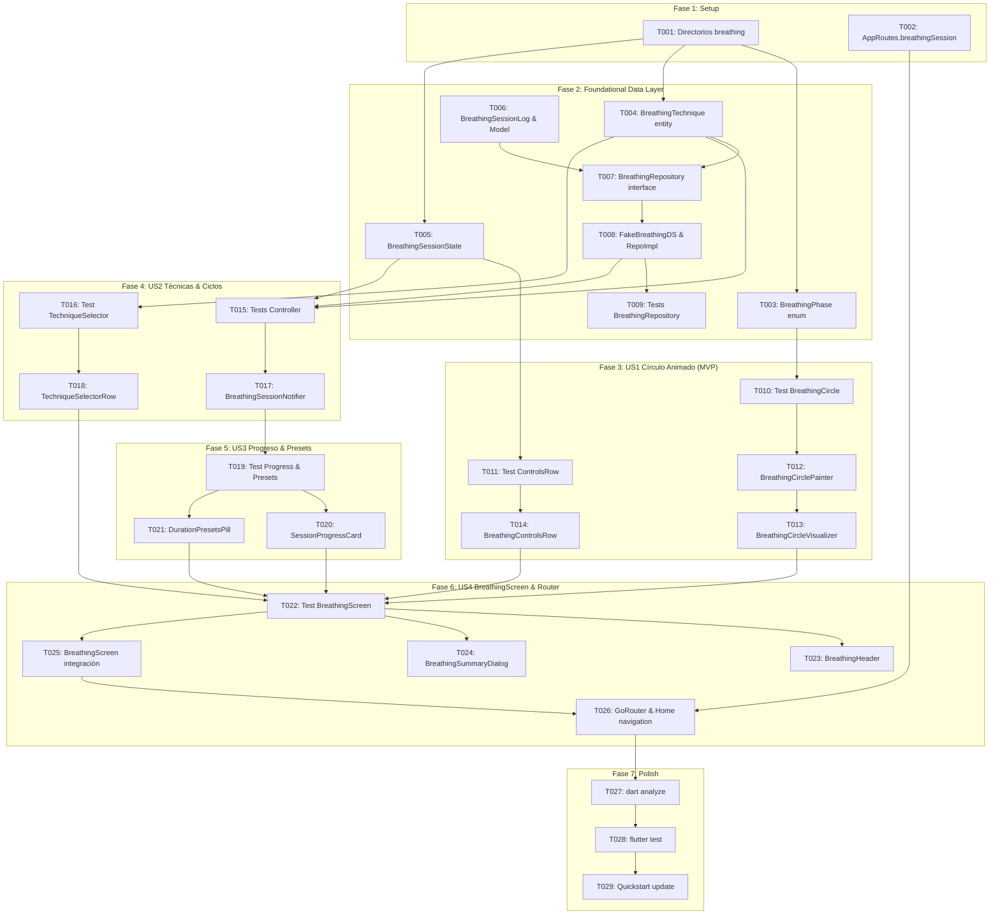

# Tasks: 004-breathing-relaxation

**Input**: Design documents from `specs/004-breathing-relaxation/`  
**Prerequisites**: `plan.md`, `spec.md`, `data-model.md`, `contracts/breathing_ui_contract.md`, `research.md`, `quickstart.md`, `.specify/memory/constitution.md`  
**Branch**: `004-breathing-relaxation`  

## Format: `[ID] [P?] [Story] Description`

- **[P]**: Puede ejecutarse en paralelo (archivos independientes sin bloqueos directos)
- **[Story]**: Historia de usuario correspondiente (`US1`, `US2`, `US3`, `US4`)
- Rutas de archivo exactas en cada tarea

---

## Phase 1: Setup (Infraestructura de Módulo)

**Purpose**: Estructura de directorios y configuración de rutas para el módulo de respiración.

- [x] T001 Crear estructura de directorios en `lib/features/breathing/` (`domain/entities/`, `domain/repositories/`, `domain/usecases/`, `data/datasources/`, `data/models/`, `data/repositories/`, `presentation/controllers/`, `presentation/widgets/`, `presentation/screens/`) y directorios de test en `test/unit/features/breathing/` y `test/widget/features/breathing/`
- [x] T002 [P] Confirmar la constante de ruta `AppRoutes.breathingSession = '/breathing-session'` en `lib/core/router/route_names.dart`

---

## Phase 2: Foundational (Modelos de Dominio, Repositorio y Estado)

**Purpose**: Entidades inmutables, catálogo de técnicas, repositorio y estado reactivo de la sesión.

- [x] T003 [P] Implementar enum `BreathingPhase` (`inhale`, `hold`, `exhale`, `rest`) con getters `instruction` y `biomechanicalHint` en `lib/features/breathing/domain/entities/breathing_phase.dart`
- [x] T004 [P] Implementar entidad `BreathingTechnique` con sus presets (`box_444`, `relaxing_478`, `serene_87`) y getter `cycleDurationSeconds` en `lib/features/breathing/domain/entities/breathing_technique.dart`
- [x] T005 [P] Implementar modelo de estado inmutable `BreathingSessionState` (técnica, fase, segundos restantes de fase, segundos transcurridos, meta, ciclo actual, ciclos totales, estado de sesión `idle`/`running`/`paused`/`completed`) en `lib/features/breathing/domain/entities/breathing_session_state.dart`
- [x] T006 [P] Implementar entidad `BreathingSessionLog` y DTO `BreathingSessionModel` con serialización para Firestore en `lib/features/breathing/data/models/breathing_session_model.dart`
- [x] T007 [P] Implementar interfaz `BreathingRepository` en `lib/features/breathing/domain/repositories/breathing_repository.dart`
- [x] T008 Implementar `FakeBreathingDataSource` en `lib/features/breathing/data/datasources/fake_breathing_datasource.dart` y `BreathingRepositoryImpl` en `lib/features/breathing/data/repositories/breathing_repository_impl.dart`
- [x] T009 [P] Escribir pruebas unitarias para `BreathingRepositoryImpl` en `test/unit/features/breathing/breathing_repository_test.dart`

**Checkpoint**: Capa de datos y entidades de respiración listas y testeadas de forma desacoplada.

---

## Phase 3: User Story 1 - Sesión de Respiración Guiada con Visualizador Circular Animado (Priority: P1) 🎯 MVP

**Goal**: Renderizar el visualizador circular animado pulsante a 60 fps con arco de progreso perimetral, instrucciones de fase ("Inhala suave", "Retén el aire", "Exhala despacio"), cuenta atrás en segundos y controles de play/pausa/reinicio.

**Independent Test**: La suite de pruebas de widgets valida que `BreathingCircleVisualizer` renderiza las fases con animación continua y `BreathingControlsRow` responde a las interacciones de inicio, pausa y reinicio.

### Tests para User Story 1
- [x] T010 [P] [US1] Escribir prueba de widget para `BreathingCircleVisualizer` en `test/widget/features/breathing/breathing_circle_visualizer_test.dart`
- [x] T011 [P] [US1] Escribir pruebas de widget para `BreathingControlsRow` (reinicio, cápsula central play/pausa y botón stop) en `test/widget/features/breathing/breathing_controls_row_test.dart`

### Implementación de User Story 1
- [x] T012 [US1] Implementar `BreathingCirclePainter` (`CustomPainter`) para dibujar el arco continuo exterior y el anillo perimetral punteado en `lib/features/breathing/presentation/widgets/breathing_circle_painter.dart`
- [x] T013 [US1] Implementar componente animado `BreathingCircleVisualizer` (escala suave de 1.0 a 1.22 según fase, icono superior de aire, texto de fase, contador numérico y texto biomecánico en mayúsculas espaciadas) en `lib/features/breathing/presentation/widgets/breathing_circle_visualizer.dart`
- [x] T014 [US1] Implementar componente `BreathingControlsRow` (botón circular de reinicio, botón central en cápsula verde oscuro y botón circular de stop) en `lib/features/breathing/presentation/widgets/breathing_controls_row.dart`

**Checkpoint**: Visualizador circular animado y controles verificables de forma independiente.

---

## Phase 4: User Story 2 - Selector de Técnicas Terapéuticas y Contador de Ciclos (Priority: P1)

**Goal**: Permitir al estudiante conmutar entre las técnicas "Caja 4-4-4", "Relajante 4-7-8" y "Serena 8-7", recalculando dinámicamente los intervalos y mostrando el avance de ciclos en la píldora superior.

**Independent Test**: Al cambiar la técnica, el controlador ajusta los tiempos de fase y el contador avanza en cada ciclo completado.

### Tests para User Story 2
- [x] T015 [P] [US2] Escribir pruebas unitarias del controlador `BreathingSessionNotifier` (avance de fases de inhalación/retención/exhalación, cálculo de ciclos e integración con técnicas) en `test/unit/features/breathing/breathing_session_controller_test.dart`
- [x] T016 [P] [US2] Escribir prueba de widget para `TechniqueSelectorRow` en `test/widget/features/breathing/technique_selector_row_test.dart`

### Implementación de User Story 2
- [x] T017 [US2] Implementar `BreathingSessionNotifier` y provider Riverpod `breathingSessionControllerProvider` en `lib/features/breathing/presentation/controllers/breathing_session_controller.dart`
- [x] T018 [US2] Implementar componente `TechniqueSelectorRow` (selector desplegable/modal con icono de aire y píldora derecha de "Ciclo X de Y") en `lib/features/breathing/presentation/widgets/technique_selector_row.dart`

**Checkpoint**: Controlador de sesión conectado con catálogo de técnicas y contador de ciclos.

---

## Phase 5: User Story 3 - Tarjeta de Progreso Temporal y Selector de Duración (Priority: P2)

**Goal**: Mostrar la tarjeta superior con el tiempo restante formateado ("07:43 / 10:00") y barra lineal de avance, permitiendo conmutar entre presets de 3 min, 5 min, 10 min o Modo Libre.

**Independent Test**: Al seleccionar un preset de duración, la tarjeta superior y el total de ciclos calculados se recalculan de forma instantánea.

### Tests para User Story 3
- [x] T019 [P] [US3] Escribir prueba de widget para `SessionProgressCard` y `DurationPresetsPill` en `test/widget/features/breathing/session_progress_card_test.dart`

### Implementación de User Story 3
- [x] T020 [US3] Implementar componente `SessionProgressCard` (icono de temporizador, tiempo digital MM:SS/MM:SS y barra horizontal lineal de avance) en `lib/features/breathing/presentation/widgets/session_progress_card.dart`
- [x] T021 [US3] Implementar selector segmentado `DurationPresetsPill` (3 min, 5 min, 10 min, Libre) en `lib/features/breathing/presentation/widgets/duration_presets_pill.dart`

**Checkpoint**: Tarjeta de progreso y presets de duración integrados y probados.

---

## Phase 6: User Story 4 - Cabecera, Modal de Resumen y Pantalla BreathingScreen (Priority: P3)

**Goal**: Orquestar la pantalla completa `BreathingScreen` según Figma ([`mindUC - Respiracion y Relajacion.png`](docs/mockups/mindUC%20-%20Respiracion%20y%20Relajacion.png)), integrando la cabecera, modal de resumen de sesión, persistencia en Firestore y enlace de navegación GoRouter desde el Dashboard de Inicio.

**Independent Test**: La suite de pruebas de widgets valida que `BreathingScreen` renderiza la composición completa, inicia/pausa la sesión, y al terminar despliega el modal de resumen y persiste los datos.

### Tests para User Story 4
- [x] T022 [P] [US4] Escribir prueba de widget integral para `BreathingScreen` en `test/widget/features/breathing/breathing_screen_test.dart`

### Implementación de User Story 4
- [x] T023 [US4] Implementar widget `BreathingHeader` (botón de retroceso, título centrado "Sesion Respiracion", subtítulo "mindUC", campana y avatar) en `lib/features/breathing/presentation/widgets/breathing_header.dart`
- [x] T024 [US4] Implementar modal de resumen sereno `BreathingSummaryDialog` (minutos dedicados, ciclos completados, felicitación amable y botones de retorno) en `lib/features/breathing/presentation/widgets/breathing_summary_dialog.dart`
- [x] T025 [US4] Integrar la pantalla completa `BreathingScreen` en `lib/features/breathing/presentation/screens/breathing_screen.dart` orquestando cabecera, selector de técnica, progreso temporal, visualizador circular, controles y presets de duración
- [x] T026 [US4] Registrar la ruta `/breathing-session` en `lib/core/router/app_router.dart` y conectar la tarjeta "Relajación" en `lib/features/home/presentation/controllers/home_dashboard_controller.dart` para navegar a `AppRoutes.breathingSession`

**Checkpoint**: Pantalla de Respiración y Relajación 100% terminada, navegable y conectada con persistencia.

---

## Phase 7: Polish & Cross-Cutting Concerns

**Purpose**: Verificación integral de calidad, linteo estricto y ejecución de suite de pruebas completa.

- [x] T027 [P] Ejecutar `dart analyze` y resolver cualquier advertencia o violación de estilo
- [x] T028 Ejecutar suite completa `flutter test` asegurando 100% de éxito en todos los tests unitarios y de widgets
- [x] T029 Actualizar `specs/004-breathing-relaxation/quickstart.md` con los comandos y casos de prueba verificados

---

## Dependencies & Execution Order

