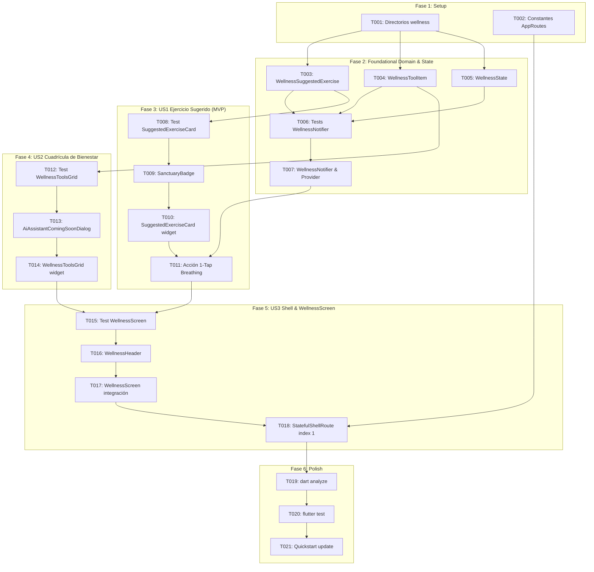

# Tasks: 005-wellness-hub

**Input**: Design documents from `specs/005-wellness-hub/`  
**Prerequisites**: `plan.md`, `spec.md`, `data-model.md`, `contracts/wellness_ui_contract.md`, `research.md`, `quickstart.md`, `.specify/memory/constitution.md`  
**Branch**: `005-wellness-hub`  

## Format: `[ID] [P?] [Story] Description`

- **[P]**: Puede ejecutarse en paralelo (archivos independientes sin bloqueos directos)
- **[Story]**: Historia de usuario correspondiente (`US1`, `US2`, `US3`)
- Rutas de archivo exactas en cada tarea

---

## Phase 1: Setup (Infraestructura de Módulo)

**Purpose**: Estructura de directorios y configuración de rutas para el Hub de Bienestar.

- [ ] T001 Crear estructura de directorios en `lib/features/wellness/` (`domain/entities/`, `presentation/controllers/`, `presentation/widgets/`, `presentation/screens/`) y directorios de test en `test/unit/features/wellness/` y `test/widget/features/wellness/`
- [ ] T002 [P] Confirmar constantes de ruta `AppRoutes.wellness = '/wellness'`, `AppRoutes.breathingSession = '/breathing-session'`, `AppRoutes.pomodoroSession = '/pomodoro-session'`, `AppRoutes.journalNew = '/journal/new'` en `lib/core/router/route_names.dart`

---

## Phase 2: Foundational (Modelos de Dominio y Estado Reactivo)

**Purpose**: Entidades inmutables, modelo de estado y controlador reactivo Riverpod.

- [ ] T003 [P] Implementar entidad inmutable `WellnessSuggestedExercise` en `lib/features/wellness/domain/entities/wellness_suggested_exercise.dart`
- [ ] T004 [P] Implementar entidad inmutable `WellnessToolItem` en `lib/features/wellness/domain/entities/wellness_tool_item.dart`
- [ ] T005 [P] Implementar modelo inmutable `WellnessState` en `lib/features/wellness/domain/entities/wellness_state.dart`
- [ ] T006 [P] Escribir pruebas unitarias para `WellnessNotifier` en `test/unit/features/wellness/wellness_controller_test.dart`
- [ ] T007 Implementar `WellnessNotifier` y provider Riverpod `wellnessControllerProvider` en `lib/features/wellness/presentation/controllers/wellness_controller.dart`

**Checkpoint**: Capa de dominio y controlador reactivo de bienestar listos y probados de forma desacoplada.

---

## Phase 3: User Story 1 - Navegación al Espacio de Bienestar y Tarjeta de Ejercicio Sugerido (Priority: P1) 🎯 MVP

**Goal**: Renderizar la cabecera serena, la píldora `🌱 SANCTUARY MODE`, el título de acogida `Tu espacio de bienestar ✨` y la tarjeta interactiva de ejercicio sugerido con inicio de respiración guiada en un solo toque (`▶ Comenzar (5 min)`).

**Independent Test**: La suite de pruebas de widgets valida que `SuggestedExerciseCard` y `SanctuaryBadge` renderizan sus contenidos con fidelidad Figma y al presionar "Comenzar (5 min)" se ejecuta la acción de navegación hacia `/breathing-session` preconfigurada.

### Tests para User Story 1
- [ ] T008 [P] [US1] Escribir prueba de widget para `SuggestedExerciseCard` y `SanctuaryBadge` en `test/widget/features/wellness/suggested_exercise_card_test.dart`

### Implementación de User Story 1
- [ ] T009 [P] [US1] Implementar componente `SanctuaryBadge` (`🌱 SANCTUARY MODE` con fondo menta suave) en `lib/features/wellness/presentation/widgets/sanctuary_badge.dart`
- [ ] T010 [US1] Implementar componente `SuggestedExerciseCard` (kicker superior, título "Respiración 4–7–8", icono de brisa en círculo, etiqueta "🟢 Ciclo guiado" y botón de cápsula `▶ Comenzar (5 min)`) en `lib/features/wellness/presentation/widgets/suggested_exercise_card.dart`
- [ ] T011 [US1] Conectar la acción de inicio rápido 1-Tap en `WellnessNotifier` para configurar técnica `relaxing478` y duración `300s` en `lib/features/wellness/presentation/controllers/wellness_controller.dart`

**Checkpoint**: Tarjeta de ejercicio sugerido y píldora de santuario verificables e interactivas de forma independiente.

---

## Phase 4: User Story 2 - Cuadrícula de Accesos Rápidos de Bienestar (Priority: P1)

**Goal**: Renderizar la cuadrícula 2x2 con tarjetas de Respiración, Diario personal, Asistente IA (manejado compasivamente según Principio VI) y Concentración Pomodoro, respetando los colores botánicos e insignias de Figma.

**Independent Test**: Al pulsar sobre cada tarjeta de la cuadrícula, el sistema navega a la ruta correspondiente o despliega el modal compasivo de fase de preparación en el caso del Asistente IA.

### Tests para User Story 2
- [ ] T012 [P] [US2] Escribir prueba de widget para `WellnessToolsGrid` y `AiAssistantComingSoonDialog` en `test/widget/features/wellness/wellness_tools_grid_test.dart`

### Implementación de User Story 2
- [ ] T013 [P] [US2] Implementar modal sereno `AiAssistantComingSoonDialog` (Principio VI diferido) en `lib/features/wellness/presentation/widgets/ai_assistant_dialog.dart`
- [ ] T014 [US2] Implementar componente `WellnessToolsGrid` (cuadrícula 2x2 con colores oficiales, insignias `3 min`, `Privado`, `24/7`, `25m`, iconos en contenedores circulares y tipografía serena) en `lib/features/wellness/presentation/widgets/wellness_tools_grid.dart`

**Checkpoint**: Cuadrícula de bienestar 2x2 completamente interactiva y protegida éticamente.

---

## Phase 5: User Story 3 - Integración con Shell y Estado de Navegación Persistente (Priority: P2)

**Goal**: Orquestar la pantalla completa `WellnessScreen`, reemplazando el placeholder de la Pestaña 2 del Shell de GoRouter (`AppRoutes.wellness`), con scroll ergonómico y persistencia de estado entre pestañas.

**Independent Test**: La suite de pruebas de widgets valida que `WellnessScreen` renderiza la composición completa y preserva el estado y posición al conmutar entre pestañas en `MainShellScreen`.

### Tests para User Story 3
- [ ] T015 [P] [US3] Escribir prueba de widget de integración para `WellnessScreen` en `test/widget/features/wellness/wellness_screen_test.dart`

### Implementación de User Story 3
- [ ] T016 [P] [US3] Implementar cabecera `WellnessHeader` (título "mindUC", subtítulo "Bienestar", campana con punto de aviso y avatar circular) en `lib/features/wellness/presentation/widgets/wellness_header.dart`
- [ ] T017 [US3] Implementar pantalla completa `WellnessScreen` orquestando cabecera, `SanctuaryBadge`, título hero `Tu espacio de bienestar ✨`, `SuggestedExerciseCard` y `WellnessToolsGrid` en `lib/features/wellness/presentation/screens/wellness_screen.dart`
- [ ] T018 [US3] Conectar `WellnessScreen` a la rama `index 1` (`AppRoutes.wellness`) del `StatefulShellRoute` en `lib/core/router/app_router.dart`

**Checkpoint**: Hub de Bienestar 100% terminado, navegable dentro del Shell persistente de mindUC.

---

## Phase 6: Polish & Cross-Cutting Concerns

**Purpose**: Verificación integral de calidad, linteo estricto y ejecución de suite de pruebas completa.

- [ ] T019 [P] Ejecutar `dart analyze` y resolver cualquier advertencia o violación de estilo
- [ ] T020 Ejecutar suite completa `flutter test` asegurando 100% de éxito en todos los tests unitarios y de widgets
- [ ] T021 Actualizar `specs/005-wellness-hub/quickstart.md` con los comandos y casos de prueba verificados

---

## Dependencies & Execution Order

