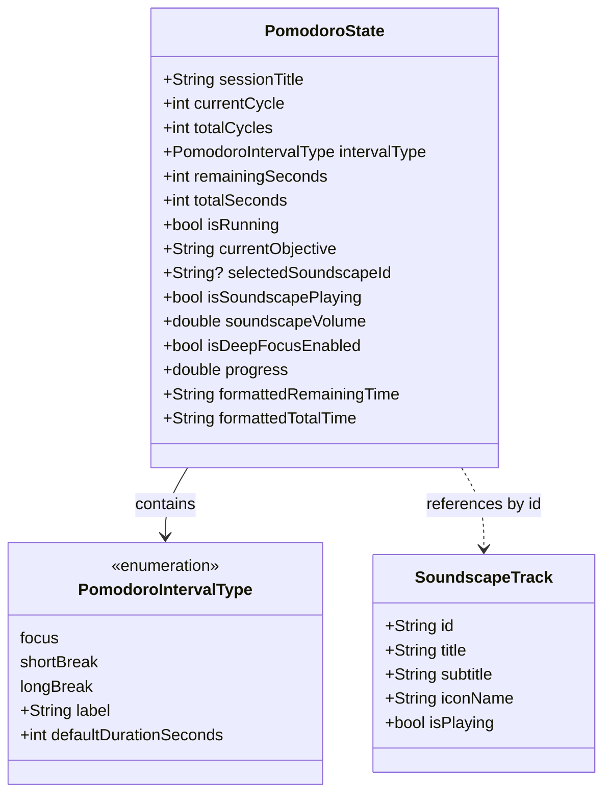
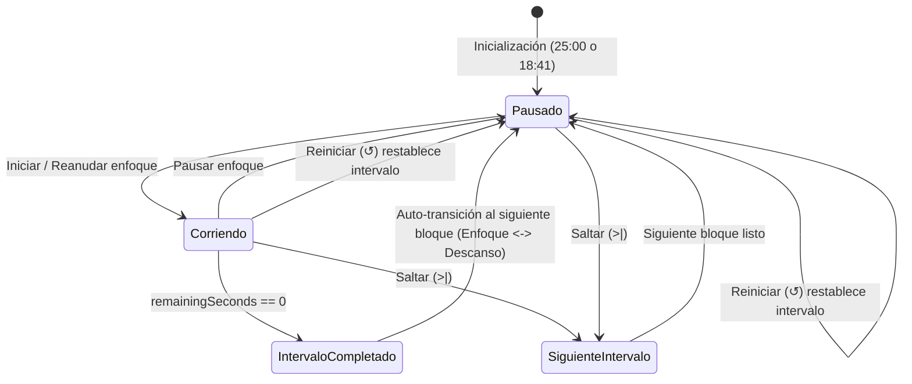

# Data Model: Concentración Pomodoro & Paisajes Sonoros (006-pomodoro-focus)

**Feature Branch**: `006-pomodoro-focus`  
**Date**: 2026-11-03  
**Status**: Ready  

---

## 1. Diagrama de Dominio

---

## 2. Entidades de Dominio

### 2.1 `PomodoroIntervalType` (Enumeración)
Representa la tipología de bloque activo dentro de la técnica Pomodoro.

| Valor | Etiqueta (`label`) | Duración por Defecto (`seconds`) | Propósito |
| :--- | :--- | :--- | :--- |
| `focus` | "Enfoque" | 1500 (25 min) | Bloque principal de concentración académica activa. |
| `shortBreak` | "Corto (5m)" | 300 (5 min) | Pausa breve de hidratación, descanso visual o respiración. |
| `longBreak` | "Largo (15m)" | 900 (15 min) | Pausa extendida al completar los 4 ciclos recomendados. |

### 2.2 `PomodoroState` (Inmutable / Value Object)
Representa el estado reactivo integral de la sesión de concentración administrada por el controlador.

| Campo | Tipo | Valor Inicial | Descripción |
| :--- | :--- | :--- | :--- |
| `sessionTitle` | `String` | `"Sesión de la tarde"` | Nombre o contexto temporal de la sesión. |
| `currentCycle` | `int` | `2` *(según mockup)* | Ciclo activo (rango 1 a `totalCycles`). |
| `totalCycles` | `int` | `4` | Número total de ciclos antes del descanso largo. |
| `intervalType` | `PomodoroIntervalType` | `PomodoroIntervalType.focus` | Intervalo en ejecución o seleccionado. |
| `remainingSeconds` | `int` | `1121` *(18 min 41 s)* | Segundos restantes del intervalo activo. |
| `totalSeconds` | `int` | `1500` *(25 min)* | Duración base del intervalo activo en segundos. |
| `isRunning` | `bool` | `false` | Indica si el temporizador está en marcha o pausado. |
| `currentObjective` | `String` | `"Lectura Cap. 4 — Psicología Social"` | Meta académica asociada visible en la tarjeta. |
| `selectedSoundscapeId` | `String?` | `"rain"` | Identificador del paisaje sonoro activo. |
| `isSoundscapePlaying` | `bool` | `true` | Estado de reproducción del ambiente sonoro. |
| `soundscapeVolume` | `double` | `0.7` | Nivel de volumen normalizado (0.0 a 1.0). |
| `isDeepFocusEnabled` | `bool` | `true` | Estado del interruptor del modo enfoque profundo consciente. |

**Getters calculados**:
- `progress`: `remainingSeconds / totalSeconds` (clamped entre 0.0 y 1.0).
- `formattedRemainingTime`: Tiempo en formato `MM:SS` (ej. `"18:41"`).
- `formattedTotalTime`: Tiempo total en formato `"de MM:SS min"` (ej. `"de 25:00 min"`).
- `isCompleted`: `remainingSeconds == 0`.

### 2.3 `SoundscapeTrack` (Entidad de Dominio)
Modela cada una de las opciones acústicas ambientales presentadas en la sección "Ambiente sonoro".

| Campo | Tipo | Ejemplo | Descripción |
| :--- | :--- | :--- | :--- |
| `id` | `String` | `"rain"` | Identificador inmutable. |
| `title` | `String` | `"Lluvia campus"` | Título de la pista ambiental. |
| `subtitle` | `String` | `"En reproducción"` | Descripción o subtítulo de estado. |
| `iconName` | `String` | `"water_drop"` / `"cloud"` | Nombre del icono representativo. |

**Pistas Predefinidas**:
1. `SoundscapeTrack(id: 'rain', title: 'Lluvia campus', subtitle: 'En reproducción', iconName: 'cloud')`
2. `SoundscapeTrack(id: 'cafe', title: 'Cafetería calma', subtitle: 'Murmullo suave', iconName: 'coffee')`
3. `SoundscapeTrack(id: 'forest', title: 'Bosque natural', subtitle: 'Natural', iconName: 'forest')`

---

## 3. Transiciones de Estado del Temporizador

