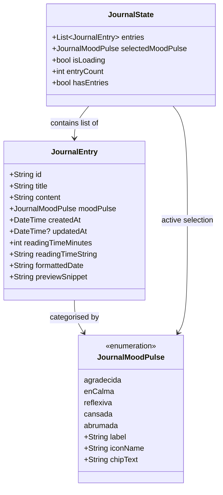

# Data Model: Diario Personal Íntimo (007-personal-journal)

**Feature Branch**: `007-personal-journal`  
**Date**: 2026-11-03  
**Status**: Ready  

---

## 1. Diagrama de Entidades de Dominio

---

## 2. Entidades de Dominio

### 2.1 `JournalMoodPulse` (Enumeración)
Representa los 5 estados de pulso afectivo disponibles en la sintonía emocional.

| Valor | Etiqueta (`label`) | `chipText` | Icono | Descripción |
| :--- | :--- | :--- | :--- | :--- |
| `agradecida` | "Agradecida" | "✨ Agradecida" | `auto_awesome` / `stars` | Sentimiento de gratitud y aprecio vital. |
| `enCalma` | "En calma" | "🌸 En calma" | `local_florist` / `spa` | Serenidad, sosiego y equilibrio mental. |
| `reflexiva` | "Reflexiva" | "🌿 Reflexiva" | `eco` / `psychology` | Introspección y procesamiento de vivencias. |
| `cansada` | "Cansada" | "☁️ Cansada" | `cloud` / `bedtime` | Fatiga física o saturación cognitiva. |
| `abrumada` | "Abrumada" | "🌊 Abrumada" | `waves` / `tsunami` | Sobrecarga de estímulos, presión o ansiedad. |

### 2.2 `JournalEntry` (Entidad de Dominio Inmutable)
Modela una reflexión íntima plasmada por el estudiante en su dispositivo.

| Campo | Tipo | Obligatorio | Descripción |
| :--- | :--- | :---: | :--- |
| `id` | `String` | Sí | Identificador único UUID de la entrada. |
| `title` | `String` | Sí | Título reflexivo (ej. "Aprender a soltar lo que no puedo controlar"). |
| `content` | `String` | Sí | Cuerpo íntegro de la reflexión personal. |
| `moodPulse` | `JournalMoodPulse` | Sí | Pulso emocional asociado al momento de escribir. |
| `createdAt` | `DateTime` | Sí | Marca temporal de creación en el dispositivo. |
| `updatedAt` | `DateTime?` | No | Marca temporal de última edición local. |

**Getters calculados**:
- `readingTimeMinutes`: Cálculo de lectura basado en ~180 palabras por minuto (`max(1, (words / 180).ceil())`).
- `readingTimeString`: Retorna `"X min de lectura"`.
- `previewSnippet`: Primeros 140 caracteres del contenido con elipsis si es extenso.
- `formattedDate`: Fecha formateada en español respetando el estilo de Figma ("Hoy, 24 Octubre · 21:15", "Ayer, 23 Octubre · 08:30").

### 2.3 `JournalState` (Value Object de Estado Reactivo)
Administrado por `JournalNotifier` en Riverpod.

| Campo | Tipo | Valor Inicial | Descripción |
| :--- | :--- | :--- | :--- |
| `entries` | `List<JournalEntry>` | 3 entradas mockup iniciales | Lista de huellas interiores ordenadas descendentemente por fecha. |
| `selectedMoodPulse` | `JournalMoodPulse` | `JournalMoodPulse.enCalma` | Pulso emocional activo seleccionado en la cabecera. |
| `isLoading` | `bool` | `false` | Indicador de carga local. |

**Getters**:
- `entryCount`: `entries.length`.
- `hasEntries`: `entries.isNotEmpty`.
